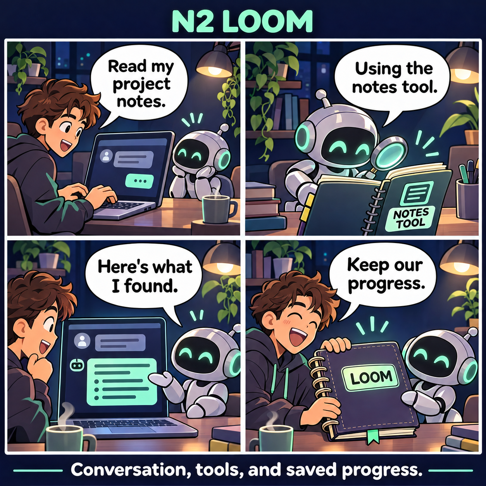
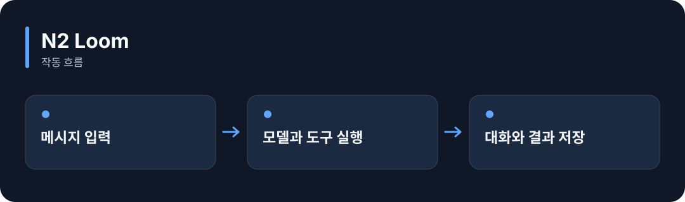

# N2 Loom

**AI와 대화하면서 도구를 실행하고, 대화와 작업 진행 내용을 저장합니다.**

[](https://github.com/choihyunsus/n2-loom/releases/tag/v1.0.0) [](https://github.com/choihyunsus/n2-loom/blob/main/docs/reference.ko.md) [](https://github.com/choihyunsus/n2-loom/blob/main/LICENSE)

[English](README.md)

<p align="center">
  
</p>

대화를 시작하고 → 등록한 도구로 자료를 읽어 → 답변을 받고 → 대화와 진행 내용을 저장합니다.

기능을 이야기로 표현한 만화입니다. 실제 앱 화면은 아닙니다.

<details>
<summary>동작 흐름 펼쳐 보기</summary>



</details>

## 이런 때 사용하세요

직접 만드는 AI 비서에 글자가 이어서 나타나는 응답, 도구 실행, 중단 후 작업 복원을 붙일 때 활용하세요.

모델 연결과 도구 등록이 필요합니다. 작업이 실제로 성공했는지를 검사하는 함수를 추가할 수 있습니다. 기본 검사는 응답 완료와 도구 처리 상태를 확인합니다.

## 처음 실행하기

터미널에서 `node --version`을 실행해 Node.js 22 이상인지 확인하세요. 아래 명령은 새 연습 폴더를 만들고 GitHub 배포 파일을 설치합니다. 예제 파일과 DB도 이 폴더에 두면 경로를 따라가기 쉽습니다.

```sh
mkdir n2-loom-demo
cd n2-loom-demo
npm init -y
npm install https://github.com/choihyunsus/n2-loom/releases/download/v1.0.0/n2-loom-1.0.0.tgz
```

설치 중 SQLite 빌드 오류가 나오면 운영체제에 맞는 C/C++ 빌드 도구가 필요할 수 있습니다. 자세한 환경 조건은 [설치 참고](https://github.com/choihyunsus/n2-loom/blob/main/docs/reference.ko.md)에 있습니다.

아래 내용을 `demo.mjs`로 저장하세요. 파일은 방금 설치 명령을 실행한 폴더에 둡니다.

먼저 Ollama를 실행하고 터미널에서 `ollama list`로 설치된 모델 이름을 확인하세요. 코드의 `YOUR_INSTALLED_MODEL`을 그 이름으로 바꿉니다. 모델이 설치되어 있어야 하며, 답변은 모델마다 달라집니다.

```js
import { Loom, ollamaChat } from 'n2-loom';
const assistant = new Loom({
  dbPath: './demo.db', project: 'demo', agent: 'assistant',
  provider: ollamaChat({ id: 'local', model: 'YOUR_INSTALLED_MODEL', contextLength: 8192, think: false }),
  limits: { contextBytes: 8192, maxOutputTokens: 512 },
});
try {
  const result = await assistant.run({
    runId: 'hello-1', conversationId: 'first-chat',
    message: 'Say hello in one short sentence.', mode: 'chat',
  });
  console.log(result.success, result.output);
} finally {
  await assistant.close();
}
```

```sh
node demo.mjs
```

성공하면 `true`와 모델이 작성한 인사가 출력됩니다. 같은 요청 ID는 저장된 결과를 재사용합니다. 새 대화를 생성하려면 `runId`를 바꾸세요.

## Soul과 함께 쓰기

여러 N2 모듈을 연결할 때 같은 `mimir.db` 파일을 지정하세요. `project`는 작업 이름, `agent`는 계속 사용할 AI 이름입니다. 같은 작업의 기록을 이어 쓰려면 이 값들을 맞춥니다. 단독 사용도 같은 필드 구조를 사용합니다.

## 다음 단계와 상세 안내

[전체 사용 안내](https://github.com/choihyunsus/n2-loom/blob/main/docs/reference.ko.md)에서 실제 앱 연결, API, 지원 범위, 복구 절차와 검증 범위를 확인할 수 있습니다. [배포 파일](https://github.com/choihyunsus/n2-loom/releases/tag/v1.0.0)에는 설치할 버전과 변경 설명이 있습니다.

처음 나오는 용어는 이렇게 읽으면 됩니다. **MCP**는 AI 앱의 도구 연결 방식, **DB**는 저장 파일, **호스트**는 이 모듈을 연결해 실행하는 앱입니다.

사용·재배포 조건은 [라이선스](https://github.com/choihyunsus/n2-loom/blob/main/LICENSE)를 확인하세요. 의존 모듈에는 별도 조건이 적용될 수 있으며, 상업 이용 조건은 상세 안내에 함께 설명되어 있습니다.
