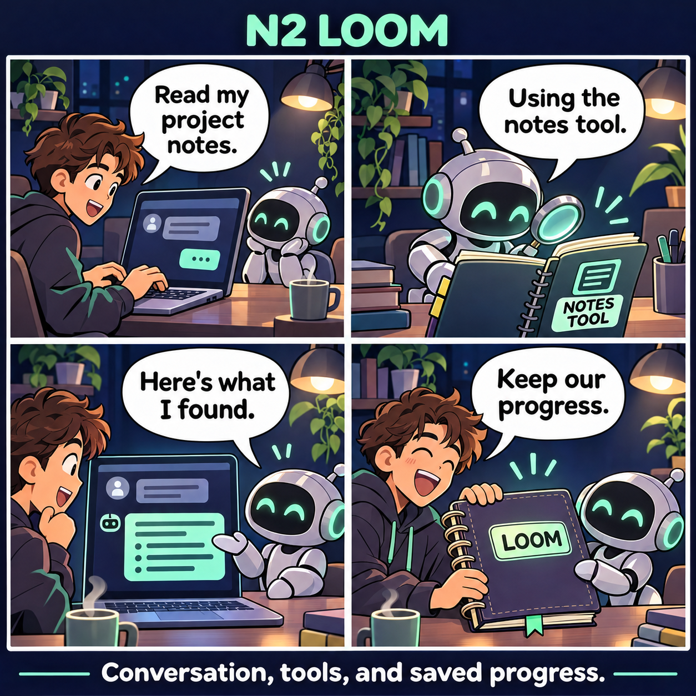
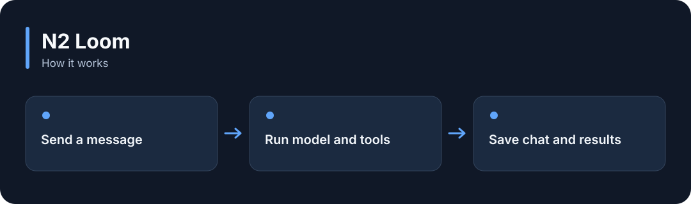

# N2 Loom

**Talk with an AI, let it use registered tools, and save the conversation and work progress.**

[](https://github.com/choihyunsus/n2-loom/releases/tag/v1.0.0) [](https://github.com/choihyunsus/n2-loom/blob/main/docs/reference.md) [](https://github.com/choihyunsus/n2-loom/blob/main/LICENSE)

[한국어](README.ko.md)

<p align="center">
  
</p>

Talk with an AI, let it use registered tools, and save the conversation and work progress.

A story illustrating the feature, rather than a screenshot of the app.

<details>
<summary>View the workflow</summary>



</details>

## When to use it

Add streaming replies, tool use and recovery after interruptions to an AI assistant you are building.

Supply a model connection and register the tools. Add your own function to verify the actual task outcome. Default checks cover response completion and recorded tool outcomes.

## Try it

Run `node --version` in a terminal and check for Node.js 22 or later. These commands create a fresh practice folder and install the GitHub release. Keep the example file and database in this folder.

```sh
mkdir n2-loom-demo
cd n2-loom-demo
npm init -y
npm install https://github.com/choihyunsus/n2-loom/releases/download/v1.0.0/n2-loom-1.0.0.tgz
```

If installation reports a SQLite build error, you may need your platform’s C/C++ build tools. See the [installation reference](https://github.com/choihyunsus/n2-loom/blob/main/docs/reference.md) for platform requirements.

Save the following as `demo.mjs` in the folder where you ran the install command.

Start Ollama and run `ollama list` to see your installed models. Replace `YOUR_INSTALLED_MODEL` with one of those names. A model must already be installed, and replies vary by model.

```js
import { Loom, ollamaChat } from 'n2-loom';
const assistant = new Loom({
  dbPath: './demo.db', project: 'demo', agent: 'assistant',
  provider: ollamaChat({ id: 'local', model: 'YOUR_INSTALLED_MODEL', contextLength: 8192, think: false }),
  limits: { contextBytes: 8192, maxOutputTokens: 512 },
});
try {
  const result = await assistant.run({
    runId: 'hello-1', conversationId: 'first-chat',
    message: 'Say hello in one short sentence.', mode: 'chat',
  });
  console.log(result.success, result.output);
} finally {
  await assistant.close();
}
```

```sh
node demo.mjs
```

On success, `true` and the model greeting appear. The same request ID reuses the stored result. Change `runId` for a new generation.

## Using it with Soul

Point connected N2 modules at the same `mimir.db` file. `project` names the work and `agent` names the AI identity you will keep using. Match those values to continue working with the same records. Standalone use follows the same field layout.

## Next steps and reference

The [full reference](https://github.com/choihyunsus/n2-loom/blob/main/docs/reference.md) covers app integration, APIs, supported features, recovery and validation. The [release page](https://github.com/choihyunsus/n2-loom/releases/tag/v1.0.0) contains the installable version and release notes.

A few terms used in the reference: **MCP** connects tools to an AI app, a **database** stores records, and the **host** is the app that connects and runs this module.

Review the [license](https://github.com/choihyunsus/n2-loom/blob/main/LICENSE) for use and redistribution. Dependencies can have their own terms, including commercial-use conditions described in the reference.
